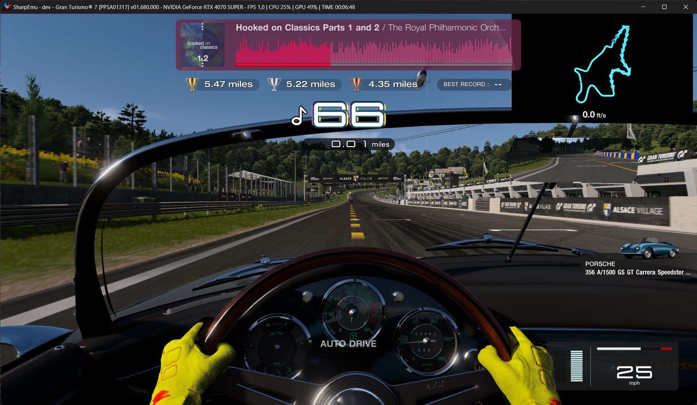
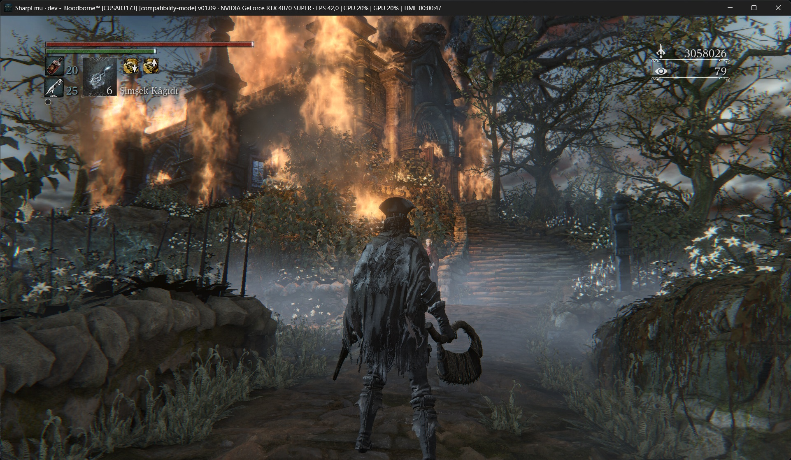
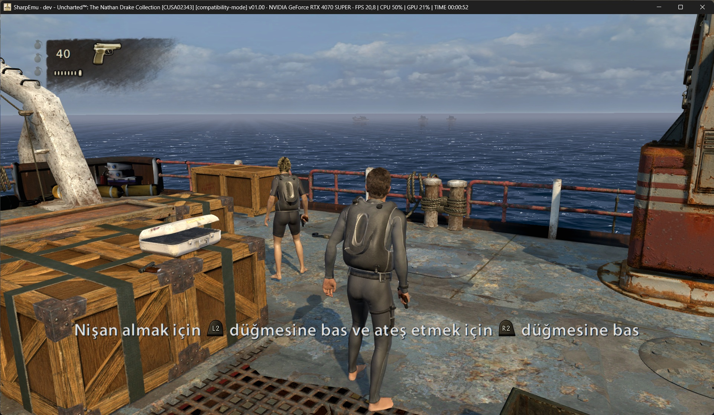

<!--
Copyright (C) 2026 SharpEmu Emulator Project
SPDX-License-Identifier: GPL-2.0-or-later
-->

# Ghost of Yōtei on SharpEmu (personal fork)

> [!NOTE]
> This is a personal fork of [SharpEmu](https://github.com/sharpemu/sharpemu) that works on one game: **Ghost of Yōtei** (PPSA26344, version 01.512.000). It is not an official SharpEmu build. Please don't report problems with it to the SharpEmu project. The work here is done with AI assistance (Claude Code and Codex).

It builds on SharpEmu `main` and on foufouadi's `yotei-good` branch, which first got the game into menus and gameplay. The working branch is `yotei-merge`.

## State (2026-11-12)

| | |
|---|---|
| Game version | 01.512.000 only (the two game-specific switches below check for it and do nothing on other versions) |
| Test machine | Ryzen 5 3600, RTX 3080 10 GB, 24 GB RAM, Windows 11 |
| Gets to | menus and gameplay; saves load |
| Frame rate | about **10.7 fps** standing in the open world, warm shader cache |
| Memory | about 15–16 GB of RAM and 9 GB of video memory while the game runs |

Frame rate standing in the open world on this machine over time: about 4 fps (2026-10-25), 6.7 fps (11-08), 10 fps (11-11), 10.7 fps (11-12).

The CPU is the limit. With every draw and compute dispatch dropped, the game's own code still needs about 30 ms a frame on this CPU, so roughly 34 fps is the ceiling here. The emulator's cost per draw and dispatch is what stands between 10.7 fps and that.

## What is different from SharpEmu

On by default, each with a switch (environment variable) that turns it off:

| Switch | Default | What it does |
|---|---|---|
| `SHARPEMU_YOTEI_LADDER=<0..21>` | 15 | The game has its own quality ladder (level of detail, number of sun shadow views, small shadow caster culling). Row 15 makes the game send about 45% fewer draws and dispatches per frame (+39% fps measured). `0` is full quality. Rows 16–21 stop drawing the player's body. |
| `SHARPEMU_YOTEI_RENDER_INDEX=<0..15>` | 15 | The size the game renders at before it upscales to 3840x2160: 0 is 3840x2160, 15 is 1920x1080. The game moves this by itself with load; holding 1920x1080 keeps it from climbing (3840x2160 measured 6.9 fps where 1920x1080 measured 10.1). `game` leaves the choice to the game. |
| `SHARPEMU_FAST_FLOAT16=<0..2>` | 2 | Shader code that works in 16-bit floats (the upscaler's accumulate pass above all) uses the graphics card's own 16-bit arithmetic and one fused multiply-add, where the exact forms rebuilt the console's rounding and NaN bits step by step. Results can differ from the console in the last bit of a multiply-add or in a NaN payload; the picture looks the same. The accumulate pass went from 11.9 ms to 3.5 ms a frame (+7.5% fps measured). `0` restores the exact forms. Changing it rebuilds the shaders once, which can take 10–15 minutes on the "Warming up shaders" screen; the build is saved every two minutes, so it carries on where it stopped if the emulator is closed. |
| `SHARPEMU_COMPUTE_TABLE_BLOCKS=1` | off | Restores the older buffer layout for compute shaders. Both layouts measured the same on this game. |
| `SHARPEMU_YOTEI_RENDER_SIZE=<W>x<H>` | off | Renders below 1920x1080, for example `1280x720` (multiples of 8, down to 640x360). It measured no gain on the test machine, where the CPU sets the pace at 1920x1080 and below (1280x720 10.0 fps, 1920x1080 9.9, 2560x1440 9.2); it is meant for graphics cards that are the limit at 1920x1080. |

The `YOTEI` switches only write data that the game's code reads: one number each for the first two, one pointer to a size table for the third. No game code and no game file is changed, and nothing is written unless the 01.512 code is found where it is expected.

Other work in this fork, in general emulator code: background pipeline compiles on several threads, a startup shader warm-up that covers every pipeline seen in earlier sessions, smaller shaders for the NVIDIA compiler, less locking and fewer system calls on paths every thread uses, and a set of measurement tools (`SHARPEMU_AB_TOGGLE_S` for in-run A/B comparisons, `SHARPEMU_MARKER_CENSUS` for draws per render pass, `SHARPEMU_LOG_VIDEOOUT_FPS` for a frame rate line every second).

## Running it

You need your own dump of the game, version 01.512.000. No game files are included or provided.

Test builds are on the [releases page](https://github.com/DarthPotato/sharpemu/releases): unzip into a new folder and drag the game's `eboot.bin` onto `run-yotei.bat`.

From source (Windows, .NET SDK from `global.json`):

```powershell
git clone -b yotei-merge https://github.com/DarthPotato/sharpemu.git
cd sharpemu
git submodule update --init --recursive
dotnet build SharpEmu.slnx -c Release
$env:SHARPEMU_WAVE64_PAIRED = "0"
$env:SHARPEMU_VK_PIPELINE_CACHE = "file"
.\artifacts\bin\Release\net10.0\win-x64\SharpEmu.exe "D:\path\to\PPSA26344\eboot.bin"
```

The first run is very slow: every shader is compiled the first time it is needed, and some take the graphics driver 30–40 seconds. Compiled shaders are kept in `user\pipeline_cache` next to the exe, and later starts show a "Warming up shaders" screen for a few minutes and then run much smoother. A fast start also relies on the graphics driver's own shader cache: after a driver update, or if that cache is cleared, the next start builds the large shaders again, which took 15–20 minutes on an RTX 3080.

## Known issues

- Low frame rate (see above).
- Freezes the first time you reach a new place (first-time shader compiles); gone on later visits.
- Lower detail than the console at the default settings: fewer shadows, shorter draw distance for small objects, 1920x1080 internal resolution.
- Visual glitches: a bright patch near the player's feet, a somewhat too-bright scene, and occasional texture flicker when video memory is nearly full.

---

The SharpEmu README follows.

# SharpEmu

<p align="center">
  
</p>

<p align="center">
  An experimental PlayStation 5 emulator for Windows and Linux, with experimental backward compatibility support for PlayStation 4 games.
</p>

---

<p align="center">
  <a href="https://discord.gg/zdTuUU9Uwn">
    
  </a>
</p>

<p align="center">
  <strong>Join our official Discord server for development updates, compatibility discussions, support, and community chat.</strong>
</p>

---

<p align="center">
  <a href="#support">
    
  </a>
</p>

---

> [!IMPORTANT]
> **Official channels:** Only **sharpemu.app** and the links listed in this GitHub repository are affiliated with SharpEmu. Any other websites, accounts, or donation pages are unofficial and unauthorized.

> [!NOTE]  
> SharpEmu supports Windows x64 and Linux x64. Windows on ARM devices
> (e.g. Snapdragon) can run the Windows x64 build through Windows' built-in
> x64 emulation. macOS support is maintained separately in
> [sharpemu/sharpemu-mac](https://github.com/sharpemu/sharpemu-mac).

> [!WARNING]  
> SharpEmu is an experimental PS5 and support backwards mode for PS4 emulator developed from scratch in C#. The current focus is on accuracy and infrastructure setup rather than game-specific compatibility.

## Info

SharpEmu is an emulator project currently in its early stages of development.

This project is developed purely for research and educational purposes. There are no commercial goals associated with it. We enjoy learning about system architecture and reverse engineering.

SharpEmu focuses exclusively on the PlayStation 5 and there is a backward compatibility mode for PS4 games.

## Selected Games

A selection of games tested with SharpEmu. This is not an exhaustive list of supported titles.

|               Demon's Souls Remake                   |                     ASTRO BOT                        |
| :-----------------------------------------------------------: | :--------------------------------------------------------------------------------------------: |
|  |  |

|                  ASTRO's PLAYROOM                    |                 Gran Turismo 7                    |
| :------------------------------------------------------------------------: | :------------------------------------------------------------------: |
|  |  |

|                  God of War: Sons of Sparta                    |                 Tomb Raider V Remastered                    |
| :------------------------------------------------------------------------: | :------------------------------------------------------------------: |
|  |  |

<p align="center">
  <a href="https://sharpemu.app/compatibility/" target="_blank"><strong><i>And more..</i></strong></a>
</p>

### Experimental backward compatibility mode

|               Bloodborne                   |                     Uncharted The Nathan Drake Collection                        |
| :-----------------------------------------------------------: | :--------------------------------------------------------------------------------------------: |
|  |  |

## Status

The emulator can currently load the `eboot.bin` of real games, execute native CPU instructions, and partially handle gpu-related functionality. Included 3D games.

SharpEmu supports Windows and Linux hosts, with video output through Vulkan.
Platform support is still experimental, so compatibility and performance vary by
game, operating system, and GPU driver. For macOS, see
[sharpemu/sharpemu-mac](https://github.com/sharpemu/sharpemu-mac).

## Using

Download the release archive for your operating system, extract it, and launch
SharpEmu with the path to a legally obtained game's `eboot.bin`.

Or command line;

Windows PowerShell:

```powershell
.\SharpEmu.exe "C:\path\to\game\eboot.bin" --log-to-file
```

Linux:

```bash
chmod +x ./SharpEmu

./SharpEmu "/path/to/game/eboot.bin" --log-to-file
```

SharpEmu supports environment variables that can be configured from the GUI. Undocumented variables are listed here: [docs/sharpemu-gui-undocumented-env-vars.md](docs/sharpemu-gui-undocumented-env-vars.md)

You can set them per game or globally in the GUI, or pass them directly through the CLI.

A Vulkan-capable GPU and current graphics driver are required.

See [Game patches](docs/patches.md) for downloading, enabling and writing game patches.

> [!IMPORTANT]  
> This project does **not** support or condone piracy.  
> All games used during development and testing are dumped from consoles that we personally own.  
> Users are expected to use legally obtained copies of their games.

## Build

1. Install the .NET SDK version specified in [`global.json`](./global.json).
2. Clone the repository: `git clone https://github.com/sharpemu/sharpemu.git`
3. Open the solution file (`SharpEmu.slnx`) in **VSCode**.
4. Build the project: `dotnet build` or `dotnet publish`
5. Build artifacts will be located in the `artifacts` directory.

## Disclaimer

SharpEmu is an experimental emulator intended for research and educational purposes.

This project does not contain any copyrighted system firmware, game data, or proprietary PlayStation assets.

## Special Thanks

The following projects were extremely helpful during development:

* **[ShadPS4](https://github.com/shadps4-emu/shadPS4)**  
Helped with understanding the basic architecture of the PlayStation 4.

* **[Kyty](https://github.com/InoriRus/Kyty)**  
One of the few PS5 emulator projects available and very useful for studying native code execution.

* **Ryujinx**  
Provided valuable references for filesystem handling and low-level C# implementation patterns.

* **[OpenGNM](https://github.com/PS4-OpenGNM/opengnm)**
Used as a reference for the general GCN architecture.

# License

- [**GPL-2.0 license**](https://github.com/sharpemu/sharpemu/blob/main/LICENSE)

## Support

Support SharpEmu via GitHub Sponsors or cryptocurrency. Every contribution helps fund ongoing development and long-term maintenance. GitHub Sponsors is the preferred way to support the project, but cryptocurrency donations are also appreciated.

### ETH/USDT

`0xF315F5d986c790bB3A58DbE60F1B2760997dEd82`

### BTC

`bc1qmr9k8899njys5ny63xsues4jgmkk96erslrkmv`

## Contributing

Before opening an issue or pull request, please read our contribution guidelines:

**[CONTRIBUTING.md](./CONTRIBUTING.md)**

The guide covers:
- Coding style and formatting
- AI-assisted contributions
- Pull request expectations
- Testing guidelines
- Legal and reverse engineering policy
